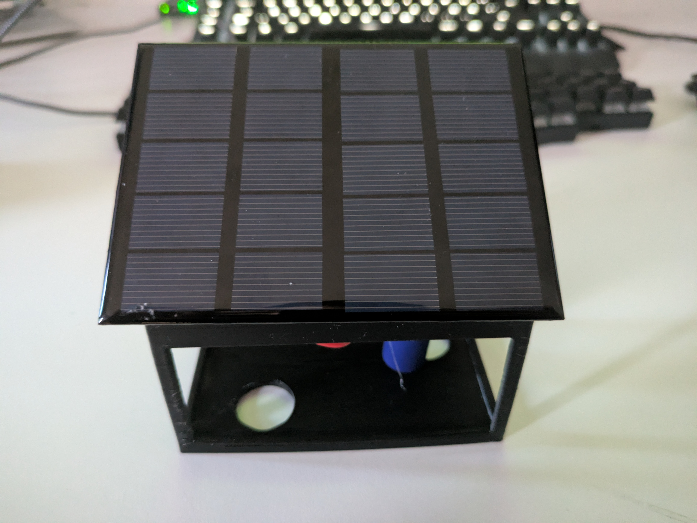
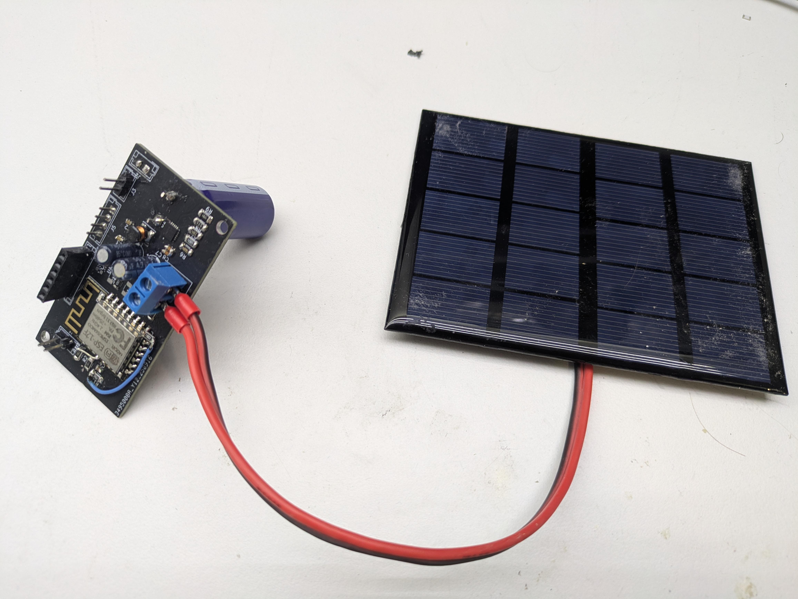

# Solar Powered Temperatur Sensor with Super Capacitor



This is a small fun project: a temperature sensor running only on solar energy, without a battery.
It contains code for the ESP8266 to connect to an MQTT server, publish its temperature, and then go into deep sleep for 10 seconds.
The Python script captures the readings and stores them in a database.
For charging, it uses a BQ25505 MPPT charger.



## Sensirion SEN69C air-quality sensor

The same collector service also ingests the SEN69C air-quality sensor from
[`../sensirion_test`](../sensirion_test):

```
SEN69C ──MQTT──> Sensirion/measurements/sen69c ──> collect.py ──> sen69c_measurements ──> Grafana
```

- `collectionScript/collect.py` subscribes to both
  `Wetterstation/measurements/#` and `Sensirion/measurements/#`.
- The topic prefix is configured with `MQTT_TOPIC_SEN69C` in
  `collectionScript/.env`.
- `database/migrations/V4__create_sen69c_measurements.sql` creates the
  `sen69c_measurements` table. The collector also applies it idempotently on
  startup, so an existing service picks it up after a restart.
- The Grafana dashboard is provisioned from
  `../stock/grafana/dashboards/sen69c.json`.

Restart the existing collector service after updating:

```bash
sudo systemctl restart collect
```
